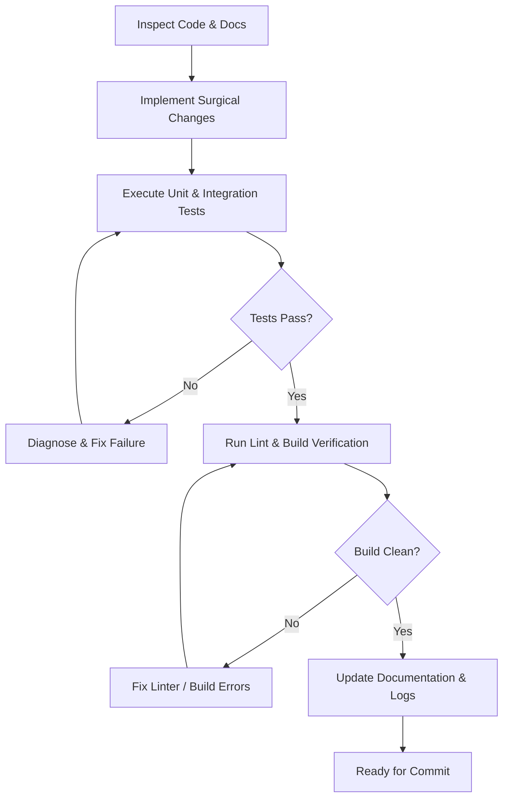

# AGENTS.md — Autonomous Agent Operating Principles & Engineering Rules

## 1. Mission & System Overview
**BatiOne** is a modern ERP and job-costing platform tailored specifically for Construction and Public Works (BTP — Bâtiment et Travaux Publics) enterprises in Morocco. It centralizes site supervision, financial control, material flows, worker time-tracking, and equipment logistics.

All autonomous AI agents (Antigravity, Claude Code, Cursor, GitHub Copilot) working in this repository MUST strictly follow the governance principles, coding standards, and verification gates outlined in this document.

---

## 2. Core Operating Principles

### 2.1. Rule Zero: Deterministic Verification & No Unverified Assumptions
- **Never guess**: Inspect existing code, database schemas, and documentation before implementing changes.
- **Always verify**: After modifying code, run linting, tests, and build checks before declaring a task complete.
- **Maintain documentation sync**: When changing schemas, API endpoints, or workflows, immediately update the corresponding docs in `docs/`.

### 2.2. Atomic, Phase-Driven Execution
- Work is organized into numbered execution phases in `docs/phases/`.
- Never jump ahead to a future phase before the current phase's verification gate has passed and been documented.
- All code changes must be mapped to an explicit phase objective or bugfix.

### 2.3. Zero Breaking Changes & Safe Migrations
- Multi-tenant data isolation is non-negotiable (`tenant_id` / `organization_id` strictly checked on every single query and mutation).
- Database migrations must be forward-compatible, reversible, and accompanied by a corresponding rollback script or verification query.
- Destructive commands (`DROP`, `TRUNCATE`, bulk deletions without WHERE clauses) require explicit confirmation and safeguards.

---

## 3. Architecture & Code Quality Standards

### 3.1. Code Cleanliness & Style
- Modular, single-responsibility functions and components.
- Strict typing (TypeScript) or exhaustive JSDoc typing where applicable.
- No dead code, obsolete comments, console logs in production paths, or temporary hack scripts committed to main.
- Explicit error handling: Every async operation, external API call, or database query must use structured try/catch or typed error returns.

### 3.2. Security & Multi-Tenancy Rules
- **Tenant Scoping**: All database queries must enforce the active tenant boundary. Never query entities across tenants unless executing a super-admin system diagnostic.
- **Role-Based Access Control (RBAC)**: All endpoints and UI actions must enforce user permissions (`Admin`, `Conducteur de Travaux`, `Chef de Chantier`, `Comptable / DAF`, `Magasinier`).
- **Input Validation**: Validate and sanitize all client inputs (using Zod or equivalent schemas) at the API boundary before passing them to services or database queries.
- **Financial Integrity**: Money, quantities, and Moroccan VAT (TVA 20%, 14%, 10%, 7%, 0%) must use integer cents (MAD in centimes) or high-precision decimals to prevent floating-point rounding errors.

### 3.3. Performance & Job Site Constraints
- Construction job sites in Morocco often suffer from intermittent 3G/4G connectivity.
- Architecture must support offline resilience, lightweight asset loading, fast TTFB, and responsive mobile-first UI for site managers.

---

## 4. Agent Workflow & Verification Gates

Before completing any task, an agent MUST run the following checklist:

1. **Pre-Flight**:
   - Read the relevant phase doc in `docs/phases/`.
   - Verify environment variables and database connectivity.
2. **Implementation**:
   - Write clean, well-tested code following the project design system and architecture conventions.
3. **Verification**:
   - Run test suite: `npm test` (or relevant test runner).
   - Run typecheck and linter: `npm run lint` / `npm run build`.
4. **Documentation**:
   - Record significant technical decisions in `docs/DECISIONS.md`.
   - Update phase status and release gates.

---

## 5. Directory & File Naming Conventions
- Documentation: `UPPER_SNAKE_CASE.md` in `docs/` and `docs/phases/`.
- Frontend Components: `PascalCase.tsx` / `PascalCase.jsx`.
- Backend Routes/Controllers: `camelCase.js` / `camelCase.ts` or `kebab-case`.
- Database Migrations: `000_sequential_name.sql`.
- Unit & Integration Tests: `<module>.test.ts` or `<module>.spec.ts` located in `tests/` or alongside source code.

---

## 6. Prohibited Practices
- ❌ Hardcoding credentials, API keys, or database URLs in repository files.
- ❌ Committing untested database migrations directly to production branches.
- ❌ Bypassing tenant filtering in queries.
- ❌ Altering financial records (invoices, payments, validated décomptes) without creating immutable audit trail entries.
- ❌ Introducing heavy unvetted external dependencies for trivial tasks.
