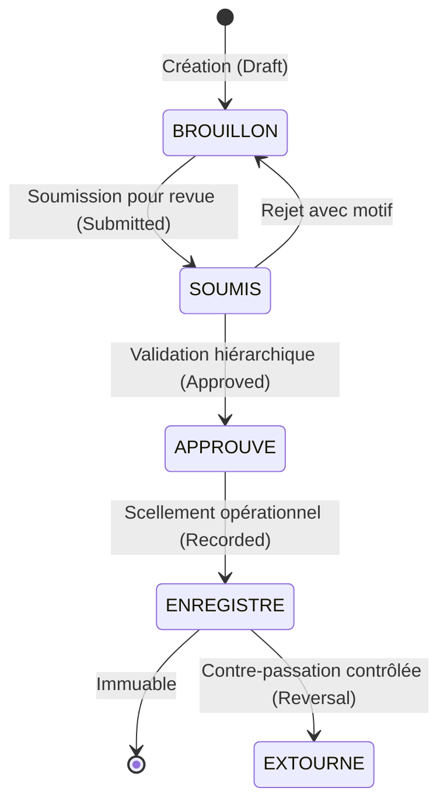

# AGENTS.md — Règles d'Ingénierie & Principes d'Opération des Agents Autonomes

## 1. Mission & Cadre Système
**BatiOne** est une plateforme SaaS cloud multi-tenant de gestion de chantier et de contrôle des coûts de projets (Job-Costing), conçue en français en priorité (French-first) pour les entreprises du secteur BTP (Bâtiment et Travaux Publics) au Maroc.

### Stack Technique Agréée
- **Frontend** : Next.js + React + TypeScript, TailwindCSS / Token CSS moderne, TanStack Query, Zustand, Next-intl (i18n-ready).
- **Backend** : NestJS + TypeScript, Architecture Modulaire (Modules, Controllers, Services, DTOs Zod/class-validator).
- **Base de Données & ORM** : PostgreSQL + Prisma ORM.
- **Tests Automatisés** : Vitest / Jest, Supertest pour l'intégration, tests unitaires et de sécurité multi-tenant.

Tous les agents IA (Antigravity, Claude Code, Cursor, GitHub Copilot) intervenant sur ce dépôt doivent respecter strictement les directives ci-dessous.

---

## 2. Invariants Métier & Règles Fondamentales

### 2.1. Règle Zéro : Vérité Vérifiée & Aucune Affirmation sans Preuve
- **Interdiction formelle de prétendre que des tests passent** sans les avoir exécutés en direct via le terminal et inspecté le résultat.
- Ne jamais deviner ni présumer des colonnes de base de données, des routes ou des types sans inspection préalable.
- Maintien rigoureux de la documentation : toute modification de schéma ou d'API doit immédiatement être répercutée dans `docs/` et `docs/PROGRESS.md`.

### 2.2. Périmètre Financier : Suivi Opérationnel & Coûts de Chantier
- **Ce que BatiOne FAIT** : Suivi des budgets de chantiers, engagement des dépenses, contrôle des coûts réels (matériaux, main-d'œuvre, engins, sous-traitance), situations de travaux / décomptes provisoires et définitifs, retenues de garantie, paiements et acomptes de chantier.
- **Ce que BatiOne NE FAIT PAS** : Comptabilité générale et statutaire légale (Plan Comptable Marocain, liasse fiscale, bilan, compte de résultat officiel). Les données financières opérationnelles sont exportables (Excel / CSV) pour les logiciels comptables tiers.

### 2.3. Cycle de Vie des Enregistrements Sensibles (4 Étapes)
Tout enregistrement opérationnel sensible (Décomptes, Factures/Dépenses de chantier, Bons de sortie de stock, Feuilles de pointage validées) respecte impérativement le cycle d'états à sens unique :

- Un enregistrement `ENREGISTRE` (Recorded) devient **strictement immuable**. Aucune modification ni suppression directe n'est tolérée en base.
- Seule une **contre-passation contrôlée (extourne / reversal)** est autorisée : création d'un enregistrement symétrique inverse, horodaté, motivé, rattaché à l'original et validé par un utilisateur habilité (`ORG_ADMIN` ou `DAF_COMPTABLE`).

### 2.4. Invariant de Stock : Blocage Absolu des Sorties Excédentaires
- **Aucun stock négatif n'est autorisé dans BatiOne.**
- Toute sortie de stock (Bon de Sortie, affectation à un chantier) doit vérifier la quantité réellement disponible dans le magasin source (magasin central ou magasin de chantier) au sein d'une transaction PostgreSQL avec verrou (`SELECT ... FOR UPDATE` ou transaction interactive Prisma).
- Si `quantité_demandée > quantité_disponible`, l'opération est **rejetée immédiatement** avec une erreur explicite `STOCK_INSUFFISANT`.

### 2.5. Isolation Multi-Tenant Stricte
- Chaque table contenant des données d'entreprise possède obligatoirement la colonne `organization_id`.
- Chaque requête, lecture ou écriture, est cloisonnée par l'organisation de l'utilisateur actif via le client Prisma sécurisé (`$extends` / middleware de tenant).
- Aucune fuite de données inter-organisations n'est admissible.

---

## 3. Architecture Logique des Modules

Le système est découpé en 9 modules interconnectés :
1. **Tableaux de Bord (Dashboard)** : Cockpit direction générale et KPIs opérationnels par chantier.
2. **Projets & Tâches (Projects / Tasks)** : Chantiers, découpage en lots/tâches, jalons, journal de chantier quotidien.
3. **Finance Opérationnelle (Finance)** : Budgets de chantiers, engagements, dépenses, décomptes provisoires/définitifs, retenue de garantie, trésorerie de chantier.
4. **Clients & Documents (Clients / Documents)** : Tiers (Maîtres d'Ouvrage, BET), devis, marchés, avenants, attachements, GED de chantier (photos, plans, PV).
5. **Stocks & Approvisionnements (Stock)** : Catalogue articles, dépôts centraux et magasins chantiers, BC, BL, bons de sortie bloquants, transferts.
6. **RH & Main d'Œuvre (HR / Labor)** : Répertoire ouvriers (permanents, journaliers, tâcherons), pointage quotidien mobile, acomptes, état préparatoire de paie.
7. **Parc Matériel & Engins (Equipment)** : Fiches engins, affectations chantiers, compteurs horaires/kilométriques, gasoil, entretien, refacturation interne.
8. **Écritures Consolidées & Audit (Consolidated Records)** : Grand livre opérationnel consolidé, traçabilité exhaustive de tous les mouvements scellés et des extournes.
9. **Utilisateurs & Permissions (Users / Permissions)** : Profils multi-tenants, authentification JWT, matrice RBAC adaptée aux métiers du BTP.

---

## 4. Protocole d'Exécution & Portes de Vérification

Avant de déclarer une tâche ou une phase terminée, l'agent doit exécuter et prouver :
1. **Linting & Formatage** : `npm run lint` sans erreur ni avertissement.
2. **Contrôle de Typage** : `npm run typecheck` sans erreur TypeScript.
3. **Exécution des Tests** : `npm test` avec affichage complet de la sortie du terminal.
4. **Build de Production** : `npm run build` réussi.
5. **Mise à Jour Documentaire** : Actualisation de `docs/PROGRESS.md` et de la documentation afférente.

---

## 5. Pratiques Proscrites
- ❌ Implémenter des fonctionnalités métier avant validation formelle de la conception.
- ❌ Utiliser des nombres à virgule flottante natifs pour les montants financiers (utiliser centimes entiers ou `Decimal`).
- ❌ Permettre une sortie de stock supérieure à la quantité disponible.
- ❌ Supprimer ou modifier un enregistrement à l'état `ENREGISTRE` (Recorded) sans passer par une extourne.
- ❌ Écrire des requêtes SQL ou Prisma sans clause `organization_id`.
- ❌ Committer des clés secrètes ou des mots de passe en clair.
