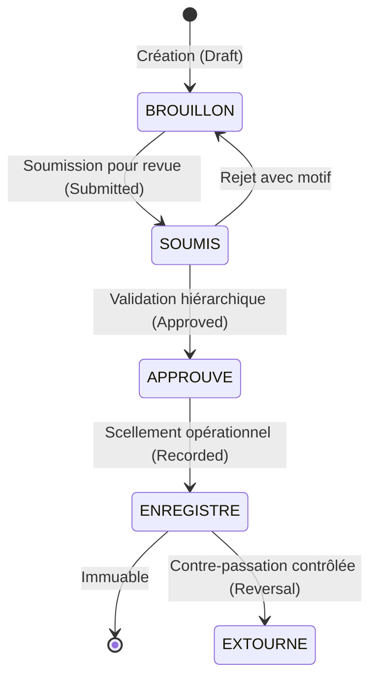

# AGENTS.md — Règles d'Ingénierie & Principes d'Opération des Agents Autonomes

## 1. Mission & Cadre Système
**BatiOne** est une plateforme SaaS cloud multi-tenant de gestion de chantier et de contrôle des coûts de projets (Job-Costing), conçue en français en priorité (French-first) pour les entreprises du secteur BTP (Bâtiment et Travaux Publics) au Maroc.

### Stack Technique Agréée
- **Frontend** : Next.js + React + TypeScript, TailwindCSS / Token CSS moderne, TanStack Query, Zustand, Next-intl (i18n-ready).
- **Backend** : NestJS + TypeScript, Architecture Modulaire (Modules, Controllers, Services, DTOs Zod/class-validator).
- **Base de Données & ORM** : PostgreSQL + Prisma ORM.
- **Tests Automatisés** : Vitest / Jest, Supertest pour l'intégration, tests unitaires et de sécurité multi-tenant.

Tous les agents IA (Antigravity, Claude Code, Cursor, GitHub Copilot) intervenant sur ce dépôt doivent respecter strictement les directives ci-dessous.

---

## 2. Invariants Métier & Règles Fondamentales

### 2.1. Règle Zéro : Vérité Vérifiée & Aucune Affirmation sans Preuve
- **Interdiction formelle de prétendre que des tests passent** sans les avoir exécutés en direct via le terminal et inspecté le résultat.
- Ne jamais deviner ni présumer des colonnes de base de données, des routes ou des types sans inspection préalable.
- Maintien rigoureux de la documentation : toute modification de schéma ou d'API doit immédiatement être répercutée dans `docs/` et `docs/PROGRESS.md`.

### 2.2. Périmètre Financier : Suivi Opérationnel & Coûts de Chantier
- **Ce que BatiOne FAIT** : Suivi des budgets de chantiers, engagement des dépenses, contrôle des coûts réels (matériaux, main-d'œuvre, engins, sous-traitance), situations de travaux / décomptes provisoires et définitifs, retenues de garantie, paiements et acomptes de chantier.
- **Ce que BatiOne NE FAIT PAS** : Comptabilité générale et statutaire légale (Plan Comptable Marocain, liasse fiscale, bilan, compte de résultat officiel). Les données financières opérationnelles sont exportables (Excel / CSV) pour les logiciels comptables tiers.

### 2.3. Cycle de Vie des Enregistrements Sensibles (4 Étapes)
Tout enregistrement opérationnel sensible (Décomptes, Factures/Dépenses de chantier, Bons de sortie de stock, Feuilles de pointage validées) respecte impérativement le cycle d'états à sens unique :

- Un enregistrement `ENREGISTRE` (Recorded) devient **strictement immuable**. Aucune modification ni suppression directe n'est tolérée en base.
- Seule une **contre-passation contrôlée (extourne / reversal)** est autorisée : création d'un enregistrement symétrique inverse, horodaté, motivé, rattaché à l'original et validé par un utilisateur habilité (`ORG_ADMIN` ou `DAF_COMPTABLE`).

### 2.4. Invariant de Stock : Blocage Absolu des Sorties Excédentaires (Décision D8/D9 — voir ADR-002 révisé)
- **Aucun stock négatif n'est autorisé dans BatiOne.**
- Mécanisme retenu : **mise à jour conditionnelle atomique en une seule instruction SQL** (`UPDATE ... SET quantite_disponible = quantite_disponible - :q WHERE id = :id AND quantite_disponible >= :q`), vérifiée par le nombre de lignes affectées — et non une lecture puis décrémentation séparées. Une contrainte `CHECK (quantite_disponible >= 0)` au niveau base de données constitue le filet de sécurité final, indépendant de la couche applicative.
- Pour un document à plusieurs lignes (Bon de Sortie multi-articles), **toutes les lignes réussissent ou échouent ensemble** dans une unique transaction interactive Prisma.
- Si `quantité_demandée > quantité_disponible`, l'opération est **rejetée immédiatement** avec une erreur explicite `STOCK_INSUFFISANT`, sans modification partielle.
- Il n'existe pas de mécanisme de réservation de stock en v1 (fonctionnalité explicitement retirée du périmètre, cf. ADR-002) : la disponibilité se lit directement sur `quantite_disponible`.

### 2.5. Isolation Multi-Tenant Stricte (Décision D10/D14 — voir ADR-005 révisé)
- Chaque table contenant des données d'entreprise possède obligatoirement la colonne `organization_id`.
- Le contexte tenant ne provient **jamais** d'un en-tête fourni par le navigateur (`X-Tenant-ID` est **supprimé** du contrat, cf. ADR-017) : il est dérivé exclusivement de l'appartenance d'organisation vérifiée dans le JWT authentifié.
- L'isolation repose sur **deux couches indépendantes, dont aucune ne remplace l'autre** :
  1. **Couche applicative** : client Prisma étendu injectant `organization_id` sur `where` ET sur les opérations de mutation (`update`/`delete` compris — pas seulement `create`).
  2. **Couche base de données (défense en profondeur)** : PostgreSQL Row-Level Security (RLS) activée sur chaque table tenant, avec contexte de transaction (`SET LOCAL app.current_org_id`) posé par le guard NestJS. Le rôle de connexion applicatif standard ne dispose **jamais** de `BYPASSRLS` ni de privilège superuser ; tout accès privilégié transverse (SUPERADMIN) passe par un rôle distinct, audité et autorisé explicitement (cf. §9 de `SECURITY_MODEL.md`).
- **Statut d'implémentation** : cette section décrit une décision d'architecture approuvée. Elle n'est, à ce stade, ni implémentée ni testée — la mise en œuvre et la vérification (RLS, tests d'écriture inter-tenant) sont des livrables de phase d'implémentation distincts du présent cadrage documentaire.
- Aucune fuite de données inter-organisations n'est admissible, en lecture comme en écriture.

---

## 3. Architecture Logique des Modules

Le système est découpé en 9 modules interconnectés :
1. **Tableaux de Bord (Dashboard)** : Cockpit direction générale et KPIs opérationnels par chantier.
2. **Projets & Tâches (Projects / Tasks)** : Chantiers, découpage en lots/tâches, jalons, journal de chantier quotidien.
3. **Finance Opérationnelle (Finance)** : Budgets de chantiers, engagements, dépenses, décomptes provisoires/définitifs, retenue de garantie, trésorerie de chantier.
4. **Clients & Documents (Clients / Documents)** : Tiers (Maîtres d'Ouvrage, BET), devis, marchés, avenants, attachements, GED de chantier (photos, plans, PV).
5. **Stocks & Approvisionnements (Stock)** : Catalogue articles, dépôts centraux et magasins chantiers, BC, BL, bons de sortie bloquants, transferts.
6. **RH & Main d'Œuvre (HR / Labor)** : Répertoire ouvriers (permanents, journaliers, tâcherons), pointage quotidien mobile, acomptes, état préparatoire de paie.
7. **Parc Matériel & Engins (Equipment)** : Fiches engins, affectations chantiers, compteurs horaires/kilométriques, gasoil, entretien, refacturation interne.
8. **Écritures Consolidées & Audit (Consolidated Records)** : Grand livre opérationnel consolidé, traçabilité exhaustive de tous les mouvements scellés et des extournes.
9. **Utilisateurs & Permissions (Users / Permissions)** : Profils multi-tenants, authentification JWT, matrice RBAC adaptée aux métiers du BTP.

---

## 4. Protocole d'Exécution & Portes de Vérification

Avant de déclarer une tâche ou une phase terminée, l'agent doit exécuter et prouver :
1. **Linting & Formatage** : `npm run lint` sans erreur ni avertissement.
2. **Contrôle de Typage** : `npm run typecheck` sans erreur TypeScript.
3. **Exécution des Tests** : `npm test` avec affichage complet de la sortie du terminal.
4. **Build de Production** : `npm run build` réussi.
5. **Mise à Jour Documentaire** : Actualisation de `docs/PROGRESS.md` et de la documentation afférente.

---

## 5. Pratiques Proscrites
- ❌ Implémenter des fonctionnalités métier avant validation formelle de la conception.
- ❌ Utiliser des nombres à virgule flottante natifs **ou des centimes entiers** pour les montants financiers — seul `Prisma.Decimal` / SQL `DECIMAL(14,2)` est autorisé (décision tranchée, cf. ADR-007 ; aucune ambiguïté résiduelle).
- ❌ Permettre une sortie de stock supérieure à la quantité disponible, ou décomposer la vérification et la décrémentation en deux opérations non atomiques.
- ❌ Supprimer ou modifier un enregistrement à l'état `ENREGISTRE` (Recorded) sans passer par une extourne ; extourner un enregistrement qui n'est pas à l'état `ENREGISTRE` ; extourner un enregistrement déjà extourné ; extourner un décompte alors qu'un décompte ultérieur du même chantier est encore `ENREGISTRE` (cf. ADR-003 révisé).
- ❌ Écrire des requêtes SQL ou Prisma sans clause `organization_id`, sur une table dépourvue de cette colonne, ou en s'appuyant uniquement sur un en-tête `X-Tenant-ID` fourni par le client comme preuve d'autorisation.
- ❌ Accorder au rôle de connexion applicatif standard le privilège `BYPASSRLS` ou un rôle superuser PostgreSQL.
- ❌ Coder en dur un taux de majoration d'heures supplémentaires ou une règle de paie sans vérification préalable auprès du droit du travail marocain en vigueur (cf. §2.3 `PRODUCT_SPEC.md`).
- ❌ Committer des clés secrètes ou des mots de passe en clair, y compris dans la documentation ou les fichiers d'exemple (`.env.example` ne contient que des valeurs fictives).
- ❌ Affirmer qu'un mécanisme de sécurité (RLS, révocation de session, sauvegarde) est implémenté ou testé tant que la preuve d'exécution correspondante n'existe pas.
