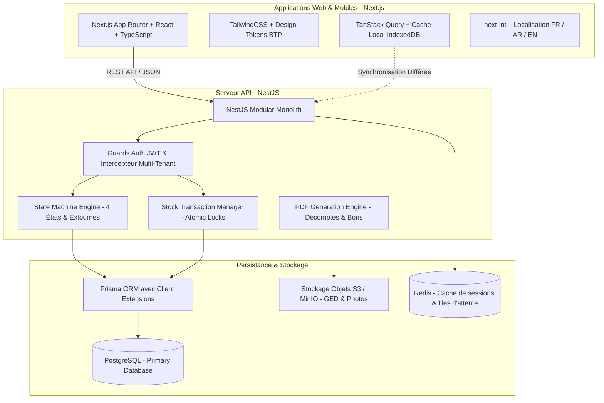

# ARCHITECTURE.md — Architecture Système & Blueprint Technique

## 1. Principes d'Architecture & Décisions Structurantes
BatiOne est conçu selon une architecture moderne, modulaire et hautement disponible, pensée pour concilier la réactivité d'une application de bureau pour les directions et la résilience hors-ligne d'un outil mobile de chantier.

- **Langue & Localisation** : Conçu en français par défaut (*French-first*), prêt pour l'internationalisation (*i18n-ready*) avec `next-intl` côté client et catalogue de messages d'erreurs traduisibles côté NestJS.
- **Approche Multi-Tenant** : Mutualisation de la base de données avec isolation logique stricte par ligne (`organization_id`) garantie au niveau de l'ORM Prisma.
- **Intégrité Opérationnelle** :
  - Cycle des documents sensibles en 4 états (`brouillon` ➔ `soumis` ➔ `approuvé` ➔ `enregistré`).
  - Immutabilité des transactions enregistrées et gestion des contre-passations (extournes).
  - Blocage transactionnel strict de toute sortie de stock excédentaire.

---

## 2. Pile Technologique (Tech Stack)



| Composant | Technologie Choisie | Rôle & Justification |
| :--- | :--- | :--- |
| **Frontend Web / Mobile** | **Next.js 14+ / React 18+ / TypeScript** | Performance SSR/SSG pour les dashboards, réactivité SPA pour les formulaires de saisie, PWA pour les chantiers. |
| **Gestion d'État & Sync** | **TanStack Query + Zustand** | Cache robuste, rafraîchissement d'arrière-plan et gestion de la file d'attente hors-ligne. |
| **Backend API** | **NestJS + TypeScript** | Architecture d'entreprise modulaire (Modules, Controllers, Services), injection de dépendances, robustesse et typage de bout en bout. |
| **ORM & Typage DB** | **Prisma ORM** | Typage strict généré à partir du schéma, migrations déterministes, extensions de client pour l'injection automatique du tenant. |
| **Base de Données** | **PostgreSQL 15+** | Robustesse ACID éprouvée, support du verrouillage transactionnel (`SELECT ... FOR UPDATE`), calculs décimaux exacts et colonnes JSONB. |
| **Stockage Documents** | **AWS S3 / Cloudflare R2 / MinIO** | Stockage sécurisé des pièces justificatives de chantier, photos horodatées et PDF générés. |
| **Génération PDF** | **PDFKit / Puppeteer** | Rendu déterministe côté serveur des documents officiels BTP (Décomptes, BPU, Bons de Commande). |

---

## 3. Structure Monorepo Recommandée

```
BatiOne/
├── apps/
│   ├── api/                   # Backend NestJS
│   │   ├── src/
│   │   │   ├── common/        # Decorators, Filters, Interceptors, Guards
│   │   │   ├── modules/       # 9 modules métier
│   │   │   │   ├── auth/
│   │   │   │   ├── organizations/
│   │   │   │   ├── chantiers/
│   │   │   │   ├── clients/
│   │   │   │   ├── devis-decomptes/
│   │   │   │   ├── depenses-finances/
│   │   │   │   ├── stock-achats/
│   │   │   │   ├── main-doeuvre/
│   │   │   │   ├── engins-materiel/
│   │   │   │   ├── ecritures-consolidees/
│   │   │   │   └── dashboard/
│   │   │   ├── main.ts
│   │   │   └── app.module.ts
│   │   └── test/              # Tests d'intégration et E2E
│   └── web/                   # Frontend Next.js
│       ├── src/
│       │   ├── app/           # Routes App Router (FR par défaut)
│       │   ├── components/    # Composants graphiques réutilisables
│       │   ├── hooks/         # Hooks React & gestion offline
│       │   ├── lib/           # Utilitaires (formatage MAD, devises, dates)
│       │   └── messages/      # Fichiers de localisation i18n (fr.json, ar.json)
├── packages/
│   ├── database/              # Schéma Prisma, migrations et client étendu
│   │   ├── prisma/
│   │   │   ├── schema.prisma
│   │   │   └── migrations/
│   │   └── src/index.ts
│   └── shared-types/          # DTOs partagés, Enums et types communs
├── docs/                      # Documentation vivante et spécifications
├── AGENTS.md                  # Manuel d'opération des agents IA
├── CLAUDE.md                  # Commandes et aide-mémoire Claude
└── package.json               # Configuration workspace
```

---

## 4. Motifs d'Architecture Clés

### 4.1. Extension Prisma pour Isolation Multi-Tenant Automatique
Pour éviter tout risque d'oubli manuel d'une clause `WHERE organization_id = :orgId`, le client Prisma est instancié avec une extension d'isolation :

```typescript
// packages/database/src/tenantClient.ts
export const createTenantPrismaClient = (prisma: PrismaClient, organizationId: string) => {
  return prisma.$extends({
    query: {
      $allModels: {
        async $allOperations({ model, operation, args, query }) {
          // Injection automatique du filtre organisationnel pour les modèles multi-tenants
          if (model !== 'Organization' && model !== 'SuperAdmin') {
            if (operation === 'findUnique' || operation === 'findFirst' || operation === 'findMany') {
              args.where = { ...args.where, organization_id: organizationId };
            }
            if (operation === 'create' || operation === 'update' || operation === 'delete') {
              if (args.data) args.data.organization_id = organizationId;
            }
          }
          return query(args);
        },
      },
    },
  });
};
```

### 4.2. Invariant de Stock Transactionnel (Zero Stock Négatif)
Pour empêcher les conditions de concurrence lors de sorties de stock simultanées, NestJS orchestre les sorties au sein d'une transaction interactive Prisma avec vérification préalable :

```typescript
// modules/stock/stock.service.ts
async enregistrerSortieStock(dto: CreerSortieStockDto, orgId: string) {
  return this.prisma.$transaction(async (tx) => {
    // 1. Verrouiller la ligne de stock du magasin source
    const stockActuel = await tx.stockMagasin.findUnique({
      where: {
        organization_id_magasin_id_article_id: {
          organization_id: orgId,
          magasin_id: dto.magasinId,
          article_id: dto.articleId,
        },
      },
    });

    if (!stockActuel || stockActuel.quantite_disponible < dto.quantite) {
      throw new BadRequestException(
        `STOCK_INSUFFISANT: Quantité disponible (${stockActuel?.quantite_disponible ?? 0}) inférieure à la demande (${dto.quantite}). Sortie impossible.`
      );
    }

    // 2. Décrémenter le stock
    const nouveauStock = await tx.stockMagasin.update({
      where: { id: stockActuel.id },
      data: {
        quantite_disponible: { decrement: dto.quantite },
      },
    });

    // 3. Créer le mouvement scellé
    await tx.mouvementStock.create({
      data: {
        organization_id: orgId,
        type_mouvement: 'SORTIE_CHANTIER',
        quantite: dto.quantite,
        chantier_id: dto.chantierId,
        statut: 'ENREGISTRE',
      },
    });

    return nouveauStock;
  });
}
```

### 4.3. Machine d'États & Extourne Contrôlée
Les services NestJS appliquent une matrice de transition stricte :
- Seul un passage `BROUILLON` ➔ `SOUMIS` ➔ `APPROUVE` ➔ `ENREGISTRE` est autorisé.
- Tout enregistrement `ENREGISTRE` verrouille les champs de la table.
- Pour annuler un enregistrement `ENREGISTRE`, une méthode dédiée `creerExtourne(id, motif)` crée un enregistrement jumeau de type `EXTOURNE` avec montants/quantités inverses, et référence la transaction d'origine.
