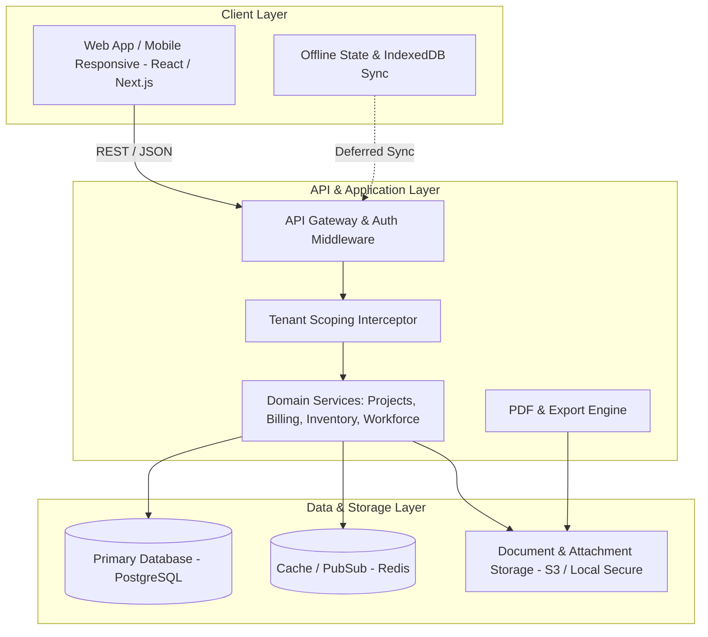

# ARCHITECTURE.md — System Architecture & Technical Blueprint

## 1. Architectural Philosophy
BatiOne is engineered as a robust, modular, multi-tenant web application optimized for desktop administration and mobile on-site field reporting. It balances high-performance backend data processing with responsive, offline-resilient client interfaces.

---

## 2. Technology Stack



| Layer | Recommended Technology | Rationale |
| :--- | :--- | :--- |
| **Frontend** | React / Vite + TailwindCSS or Vanilla CSS Token System | Instant load time, lightweight mobile bundle, smooth SPA experience |
| **State & Query** | TanStack Query (React Query) + Zustand | Robust caching, background re-validation, offline mutation queues |
| **Backend** | Node.js (Express / Fastify or Next.js API Routes) | High concurrency, JSON-native, strong ecosystem for PDF/document generation |
| **Database** | PostgreSQL | Strict relational integrity, JSONB support for dynamic form fields, high financial consistency |
| **ORM / Query Builder** | Prisma or Drizzle ORM | Type-safe queries, deterministic migration system, transparent tenant scoping |
| **File Storage** | AWS S3 / MinIO / Local Secure Storage | Encrypted storage for site photos, scanned delivery notes (BLs), and generated PDF décomptes |
| **Document Generation** | PDFKit / React-PDF / Puppeteer | Moroccan compliant layout for official Bordereaux, Décomptes, and Invoices |

---

## 3. System Directory Layout

```
BatiOne/
├── docs/                      # Architectural, Product, and Governance Docs
│   ├── phases/                # Milestone delivery phases
│   ├── PRODUCT_SPEC.md
│   ├── ARCHITECTURE.md
│   ├── DATABASE_SCHEMA.md
│   ├── API_CONTRACTS.md
│   ├── SECURITY_MODEL.md
│   ├── TEST_STRATEGY.md
│   ├── ROADMAP.md
│   └── DECISIONS.md
├── AGENTS.md                  # Autonomous agent operating manual
├── CLAUDE.md                  # Assistant quick reference & commands
├── src/                       # Application Source Code
│   ├── client/                # Frontend Application (React)
│   │   ├── components/        # Reusable UI components (Design System)
│   │   ├── hooks/             # Custom React hooks (auth, sync, queries)
│   │   ├── pages/ / views/    # Dashboard, Chantiers, Devis, Pointage, Stocks
│   │   ├── services/          # API client connectors
│   │   └── utils/             # Formatters (currency MAD, date, TVA calculations)
│   ├── server/                # Backend Application
│   │   ├── controllers/       # HTTP request handlers
│   │   ├── services/          # Business logic & financial calculations
│   │   ├── models/ / db/      # Database schema, migrations, queries
│   │   ├── middleware/        # Auth, tenant isolation, rate limiter, audit
│   │   └── lib/               # PDF generator, export workers
├── tests/                     # Automated Test Suites
│   ├── unit/                  # Pure logic & financial calculation tests
│   ├── integration/           # API endpoint & database tests
│   └── security/              # Multi-tenant leak & RBAC penetration tests
└── package.json               # Dependencies & scripts
```

---

## 4. Key Architectural Patterns

### 4.1. Row-Level Multi-Tenant Isolation
All tenant-specific tables feature `organization_id`.
- The authentication middleware extracts `organizationId` from verified session tokens.
- The database abstraction layer injects `WHERE organization_id = ?` into every `SELECT`, `UPDATE`, and `DELETE`.
- Unscoped queries trigger an automated runtime exception in non-superadmin contexts.

### 4.2. Double-Entry Job Costing Ledger
To guarantee accounting accuracy, chantier expenses are tracked through a ledger model:
- Every expense event (purchase, delivery receipt, worker pointage, machinery fuel) records:
  - Source account (e.g., Bank, Petty Cash, Supplier Credit).
  - Target chantier & cost category (`MATERIAUX`, `MAIN_D_OEUVRE`, `MATERIEL`, `SOUS_TRAITANCE`).
  - Unit quantity, unit rate, and total cost in MAD.
- Ledger entries are immutable. Corrections are performed via reversing offset entries.

### 4.3. Offline-First Field Operations (Mobile Resilient)
Field managers (Chefs de Chantier) frequently record pointage and upload delivery notes in basement levels or rural sites without reliable signal.
- Local storage (IndexedDB) holds the current site's active worker list and material catalog.
- Mutations (e.g., `SUBMIT_DAILY_POINTAGE`, `CAPTURE_DELIVERY_NOTE`) are saved to an offline synchronization queue.
- A service worker triggers bi-directional background sync once network connectivity is re-established.
