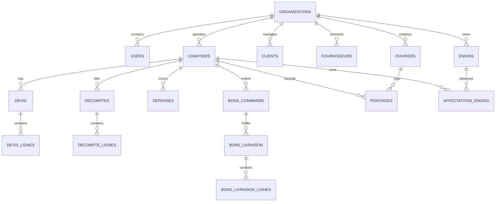

# DATABASE_SCHEMA.md — Relational Data Model & Schemas

## 1. Overview
The BatiOne schema is structured for multi-tenant isolation, high data integrity, strict audit logging, and precise financial calculations for Moroccan construction operations.

All monetary values are stored as integers representing **centimes** (e.g., 100.00 MAD = `10000`) or `DECIMAL(14, 2)` to eliminate IEEE 754 floating-point inaccuracies.

---

## 2. Entity Relationship Diagram



---

## 3. Core Tables Specification

### 3.1. Organization & User Management
```sql
-- Organizations (Tenants)
CREATE TABLE organizations (
    id UUID PRIMARY KEY DEFAULT gen_random_uuid(),
    nom VARCHAR(255) NOT NULL,
    ice VARCHAR(15) UNIQUE NOT NULL,      -- Identifiant Commun de l'Entreprise (Morocco)
    rc VARCHAR(50),                       -- Registre de Commerce
    if_num VARCHAR(50),                   -- Identifiant Fiscal
    patente VARCHAR(50),
    adresse TEXT,
    ville VARCHAR(100) DEFAULT 'Casablanca',
    telephone VARCHAR(50),
    email VARCHAR(255),
    devise VARCHAR(10) DEFAULT 'MAD',
    logo_url TEXT,
    created_at TIMESTAMP WITH TIME ZONE DEFAULT CURRENT_TIMESTAMP,
    updated_at TIMESTAMP WITH TIME ZONE DEFAULT CURRENT_TIMESTAMP
);

-- Users
CREATE TABLE users (
    id UUID PRIMARY KEY DEFAULT gen_random_uuid(),
    organization_id UUID NOT NULL REFERENCES organizations(id) ON DELETE CASCADE,
    nom VARCHAR(100) NOT NULL,
    prenom VARCHAR(100) NOT NULL,
    email VARCHAR(255) UNIQUE NOT NULL,
    password_hash VARCHAR(255) NOT NULL,
    role VARCHAR(50) NOT NULL CHECK (role IN (
        'SUPERADMIN', 
        'ORG_ADMIN', 
        'CONDUCTEUR_TRAVAUX', 
        'CHEF_CHANTIER', 
        'DAF_COMPTABLE', 
        'MAGASINIER'
    )),
    telephone VARCHAR(50),
    cin VARCHAR(20),                      -- Carte d'Identité Nationale
    actif BOOLEAN DEFAULT TRUE,
    created_at TIMESTAMP WITH TIME ZONE DEFAULT CURRENT_TIMESTAMP,
    updated_at TIMESTAMP WITH TIME ZONE DEFAULT CURRENT_TIMESTAMP
);
CREATE INDEX idx_users_org ON users(organization_id);
```

### 3.2. Chantiers & Projects
```sql
CREATE TABLE chantiers (
    id UUID PRIMARY KEY DEFAULT gen_random_uuid(),
    organization_id UUID NOT NULL REFERENCES organizations(id) ON DELETE CASCADE,
    code_chantier VARCHAR(50) NOT NULL,   -- e.g. 'CH-2026-004'
    nom VARCHAR(255) NOT NULL,
    client_id UUID REFERENCES clients(id),
    conducteur_id UUID REFERENCES users(id),
    chef_chantier_id UUID REFERENCES users(id),
    statut VARCHAR(50) DEFAULT 'ETUDE' CHECK (statut IN (
        'ETUDE', 'EN_COURS', 'RECEPTION_PROVISOIRE', 'RECEPTION_DEFINITIVE', 'CLOTURE', 'SUSPENDU'
    )),
    adresse TEXT,
    ville VARCHAR(100),
    date_demarrage DATE,
    date_fin_prevue DATE,
    date_fin_reelle DATE,
    budget_previsionnel_mad BIGINT DEFAULT 0, -- Stored in centimes
    montant_marche_ht_mad BIGINT DEFAULT 0,
    taux_tva NUMERIC(5, 2) DEFAULT 20.00,
    taux_retenue_garantie NUMERIC(5, 2) DEFAULT 10.00, -- Standard 10% or 5%
    created_at TIMESTAMP WITH TIME ZONE DEFAULT CURRENT_TIMESTAMP,
    updated_at TIMESTAMP WITH TIME ZONE DEFAULT CURRENT_TIMESTAMP,
    UNIQUE(organization_id, code_chantier)
);
CREATE INDEX idx_chantiers_org_statut ON chantiers(organization_id, statut);
```

### 3.3. Bordereau des Prix, Devis & Décomptes (Invoicing)
```sql
-- Devis / Marché Bordereau des Prix
CREATE TABLE devis (
    id UUID PRIMARY KEY DEFAULT gen_random_uuid(),
    organization_id UUID NOT NULL REFERENCES organizations(id) ON DELETE CASCADE,
    chantier_id UUID NOT NULL REFERENCES chantiers(id) ON DELETE CASCADE,
    reference VARCHAR(50) NOT NULL,       -- e.g. 'DEV-2026-012'
    objet TEXT NOT NULL,
    total_ht_mad BIGINT DEFAULT 0,
    total_tva_mad BIGINT DEFAULT 0,
    total_ttc_mad BIGINT DEFAULT 0,
    statut VARCHAR(50) DEFAULT 'BROUILLON' CHECK (statut IN ('BROUILLON', 'ENVOYE', 'VALIDE', 'REFUSE')),
    date_emission DATE NOT NULL,
    created_at TIMESTAMP WITH TIME ZONE DEFAULT CURRENT_TIMESTAMP
);

CREATE TABLE devis_lignes (
    id UUID PRIMARY KEY DEFAULT gen_random_uuid(),
    devis_id UUID NOT NULL REFERENCES devis(id) ON DELETE CASCADE,
    numero_prix VARCHAR(50),              -- e.g. '1.01', '1.02'
    designation TEXT NOT NULL,
    unite VARCHAR(20) NOT NULL,           -- 'm²', 'm³', 'ml', 'u', 'kg', 'forfait'
    quantite NUMERIC(12, 3) NOT NULL,
    prix_unitaire_mad BIGINT NOT NULL,    -- Centimes
    total_ligne_ht_mad BIGINT NOT NULL
);

-- Décomptes Provisoires & Définitifs (BTP Invoicing)
CREATE TABLE decomptes (
    id UUID PRIMARY KEY DEFAULT gen_random_uuid(),
    organization_id UUID NOT NULL REFERENCES organizations(id) ON DELETE CASCADE,
    chantier_id UUID NOT NULL REFERENCES chantiers(id) ON DELETE CASCADE,
    numero_decompte INT NOT NULL,         -- Décompte N° 1, 2, 3...
    type_decompte VARCHAR(50) DEFAULT 'PROVISOIRE' CHECK (type_decompte IN ('PROVISOIRE', 'DERNIER_PROVISOIRE', 'DEFINITIF')),
    periode_debut DATE NOT NULL,
    periode_fin DATE NOT NULL,
    cumul_precedent_ht_mad BIGINT DEFAULT 0,
    cumul_mois_ht_mad BIGINT DEFAULT 0,
    cumul_total_ht_mad BIGINT DEFAULT 0,
    retenue_garantie_mad BIGINT DEFAULT 0, -- Deducted retention
    montant_net_ht_mad BIGINT DEFAULT 0,
    montant_tva_mad BIGINT DEFAULT 0,
    montant_net_ttc_mad BIGINT DEFAULT 0,
    statut VARCHAR(50) DEFAULT 'BROUILLON' CHECK (statut IN ('BROUILLON', 'SOUMIS', 'APPROUVE', 'PAYE')),
    created_at TIMESTAMP WITH TIME ZONE DEFAULT CURRENT_TIMESTAMP
);
```

### 3.4. Dépenses & Suivi des Coûts Réels (Job Costing)
```sql
CREATE TABLE depenses (
    id UUID PRIMARY KEY DEFAULT gen_random_uuid(),
    organization_id UUID NOT NULL REFERENCES organizations(id) ON DELETE CASCADE,
    chantier_id UUID NOT NULL REFERENCES chantiers(id) ON DELETE CASCADE,
    categorie VARCHAR(50) NOT NULL CHECK (categorie IN (
        'MATERIAUX', 'MAIN_D_OEUVRE', 'MATERIEL_ENGINS', 'SOUS_TRAITANCE', 'FRAIS_GENERAUX'
    )),
    date_depense DATE NOT NULL,
    fournisseur_id UUID REFERENCES fournisseurs(id),
    piece_justificative_ref VARCHAR(100), -- Facture N°, BL N°, Reçu
    justificatif_url TEXT,
    montant_ht_mad BIGINT NOT NULL,
    taux_tva NUMERIC(5, 2) DEFAULT 20.00,
    montant_ttc_mad BIGINT NOT NULL,
    mode_paiement VARCHAR(50) CHECK (mode_paiement IN ('VIREMENT', 'CHEQUE', 'EFFET', 'ESPECES', 'CAISSE_CHANTIER')),
    statut_paiement VARCHAR(50) DEFAULT 'EN_ATTENTE' CHECK (statut_paiement IN ('EN_ATTENTE', 'PARTIEL', 'REGLE')),
    description TEXT,
    created_at TIMESTAMP WITH TIME ZONE DEFAULT CURRENT_TIMESTAMP
);
CREATE INDEX idx_depenses_chantier_cat ON depenses(chantier_id, categorie);
```

### 3.5. Ouvriers & Pointages Journaliers
```sql
CREATE TABLE ouvriers (
    id UUID PRIMARY KEY DEFAULT gen_random_uuid(),
    organization_id UUID NOT NULL REFERENCES organizations(id) ON DELETE CASCADE,
    nom VARCHAR(100) NOT NULL,
    prenom VARCHAR(100) NOT NULL,
    cin VARCHAR(20),
    metier VARCHAR(100) NOT NULL,         -- e.g. 'Maçon', 'Ferrailleur', 'Coffreur', 'Électricien', 'Manœuvre'
    type_contrat VARCHAR(50) DEFAULT 'JOURNALIER' CHECK (type_contrat IN ('CDI', 'CDD', 'JOURNALIER', 'TACHERON')),
    taux_journalier_mad BIGINT NOT NULL,  -- Daily rate in centimes
    taux_horaire_mad BIGINT DEFAULT 0,
    actif BOOLEAN DEFAULT TRUE
);

CREATE TABLE pointages (
    id UUID PRIMARY KEY DEFAULT gen_random_uuid(),
    organization_id UUID NOT NULL REFERENCES organizations(id) ON DELETE CASCADE,
    chantier_id UUID NOT NULL REFERENCES chantiers(id) ON DELETE CASCADE,
    ouvrier_id UUID NOT NULL REFERENCES ouvriers(id) ON DELETE CASCADE,
    date_pointage DATE NOT NULL,
    statut_presence VARCHAR(20) DEFAULT 'PRESENT' CHECK (statut_presence IN ('PRESENT', 'DEMI_JOURNEE', 'ABSENT', 'CONGE')),
    heures_regulieres NUMERIC(4, 2) DEFAULT 8.00,
    heures_supplementaires NUMERIC(4, 2) DEFAULT 0.00,
    cout_total_mad BIGINT NOT NULL,       -- Automatically calculated for job costing
    valide_par_chef UUID REFERENCES users(id),
    created_at TIMESTAMP WITH TIME ZONE DEFAULT CURRENT_TIMESTAMP,
    UNIQUE(chantier_id, ouvrier_id, date_pointage)
);
CREATE INDEX idx_pointages_chantier_date ON pointages(chantier_id, date_pointage);
```

### 3.6. Engins & Matériel de Chantier
```sql
CREATE TABLE engins (
    id UUID PRIMARY KEY DEFAULT gen_random_uuid(),
    organization_id UUID NOT NULL REFERENCES organizations(id) ON DELETE CASCADE,
    code_interne VARCHAR(50) NOT NULL,    -- e.g. 'ENG-001'
    nom VARCHAR(150) NOT NULL,            -- e.g. 'Grue à tour Potain', 'Pelleteuse CAT 320'
    categorie VARCHAR(50) NOT NULL,       -- 'TERRASSEMENT', 'LEVAGE', 'TRANSPORT', 'PETIT_MATERIEL'
    immatriculation VARCHAR(50),
    cout_horaire_mad BIGINT DEFAULT 0,    -- Cost allocated per hour of operation
    cout_journalier_mad BIGINT DEFAULT 0,
    compteur_horaire NUMERIC(10, 2) DEFAULT 0.00,
    statut VARCHAR(50) DEFAULT 'DISPONIBLE' CHECK (statut IN ('DISPONIBLE', 'AFFECTE', 'EN_PANNE', 'EN_MAINTENANCE'))
);

CREATE TABLE affectations_engins (
    id UUID PRIMARY KEY DEFAULT gen_random_uuid(),
    engin_id UUID NOT NULL REFERENCES engins(id) ON DELETE CASCADE,
    chantier_id UUID NOT NULL REFERENCES chantiers(id) ON DELETE CASCADE,
    date_debut DATE NOT NULL,
    date_fin DATE,
    cout_calcule_mad BIGINT DEFAULT 0
);
```
