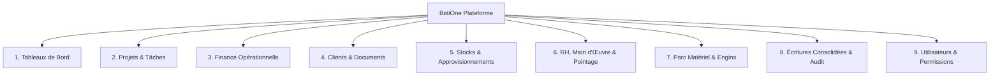

# PRODUCT_SPEC.md — Spécification Produit BatiOne

## 1. Vision & Positionnement Stratégique
**BatiOne** est une plateforme SaaS cloud multi-tenant de gestion de chantier et de contrôle des coûts de projets (Job-Costing), développée en priorité en langue française (French-first) avec une architecture prête pour l'internationalisation (i18n), destinée aux entreprises de BTP (Bâtiment et Travaux Publics) au Maroc.

### 1.1. Délimitation du Périmètre Financier
- **Périmètre Inclus (Opérationnel & Contrôle de Gestion)** :
  - Établissement des budgets prévisionnels de chantiers par poste (Matériaux, Main-d'œuvre, Matériel, Sous-traitance, Frais généraux).
  - Suivi des engagements et dépenses réelles de chantier.
  - Cycle de facturation client BTP : métrés, attachements, décomptes provisoires et définitifs, gestion automatique des retenues de garantie (5% ou 10%) et de la TVA marocaine.
  - Gestion des encaissements clients, des délais de paiement et de la trésorerie opérationnelle de chantier.
  - Refacturation interne des heures d'engins et du matériel.
- **Périmètre Exclu (Comptabilité Statutaire Légale)** :
  - BatiOne **n'est pas** un logiciel de comptabilité générale ou fiscale légale.
  - BatiOne ne gère pas le bilan comptable officiel, le compte de résultat fiscal (CPC), les écritures de clôture d'exercice ou la liasse fiscale marocaine.
  - BatiOne propose en revanche des exports consolidés structurés (Excel, CSV, API) pour alimenter les progiciels comptables externes (Sage, Cegid, Odoo, etc.).

---

## 2. Personas Métiers BTP au Maroc

| Persona | Titre Opérationnel | Rôle & Besoins Clés |
| :--- | :--- | :--- |
| **Directeur Général / Gérant** | Dirigeant PME / ETI BTP | Visibilité consolidée sur l'ensemble du parc de chantiers, rentabilité en temps réel, alertes dépassement budget, trésorerie globale. |
| **Conducteur de Travaux** | Ingénieur Travaux | Pilotage de 2 à 5 chantiers, validation des commandes de matériaux, suivi de l'avancement physique vs financier, approbation des décomptes et situations. |
| **Chef de Chantier** | Responsable Terrain | Saisie rapide et mobile du pointage des équipes (journaliers et permanents), réception sur site des matériaux (vérification BL), journal de chantier quotidien. |
| **DAF / Responsable Administratif & Financier** | Gestionnaire Finance | Rapprochement 3 voies (BC ➔ BL ➔ Facture), génération des décomptes clients avec retenue de garantie, suivi des règlements fournisseurs et de la caisse de chantier. |
| **Magasinier / Gestionnaire Stock** | Responsable Magasin | Entrées en stock, gestion des dépôts centraux et de chantier, préparation des bons de sortie, contrôle strict des niveaux de stock sans rupture ni stock négatif. |
| **Responsable Matériel** | Chef de Parc Engins | Gestion des affectations d'engins (grues, pelleteuses, camions), suivi des compteurs horaires, entretien, contrôle des consommations de gasoil. |

---

## 3. Les 9 Modules Fonctionnels

### Module 1 : Tableaux de Bord (Dashboard)
- **Cockpit Direction Générale** : Chiffre d'affaires engagé vs facturé vs encaissé, marge nette globale, encours des décomptes en attente de paiement par Maître d'Ouvrage, chantiers en alerte de dépassement de coût.
- **Tableau de Bord par Chantier** : Avancement physique (%), consommation budgétaire par lot, marge brute opérationnelle, météo et incidents du jour.
- **Widgets d'alerte** : Stock minimum atteint, retards d'attachements, anomalies de pointage.

### Module 2 : Projets & Tâches (Projects / Tasks)
- **Fiche Chantier Complète** : Code chantier unique, désignation, localisation géographique (régions du Maroc), dates contractuelles, équipe affectée (Conducteur, Chef de chantier).
- **Structure de Découpage du Projet** : Lots de travaux (Terrassement, Gros Œuvre, Étanchéité, Second Œuvre, VRD), phases et jalons critiques.
- **Journal de Chantier Quotidien** : Conditions météorologiques, effectifs présents, travaux exécutés par corps d'état, livraisons reçues, incidents de sécurité, photos horodatées avec géolocalisation facultative.

### Module 3 : Finance Opérationnelle & Décomptes (Finance)
- **Budget Prévisionnel de Chantier** : Décomposition par postes de coûts (Matériaux, MO, Engins, Sous-traitance, Frais généraux).
- **Engagements & Dépenses** : Enregistrement des bons de commande émis, validation des dépenses réelles, imputation analytique par chantier.
- **Décomptes Provisoires & Définitifs (Facturation Client)** :
  - Mécanisme cumulatif des situations de travaux selon les attachements approuvés.
  - Déduction automatique des décomptes antérieurs.
  - Application automatique de la Retenue de Garantie (5% ou 10%) consignée jusqu'à la Réception Définitive.
  - Calcul rigoureux de la TVA marocaine (20%, 14%).
- **Suivi de la Caisse de Chantier** : Avances et menues dépenses de chantier justifiées par reçus.

### Module 4 : Clients, Marchés & Documents (Clients / Documents)
- **Répertoire Tiers** : Maîtres d'Ouvrage, Bureaux d'Études Techniques (BET), Bureaux de Contrôle, Sous-traitants. Identifiants marocains (ICE, RC, IF, Patente).
- **Devis & Bordereau des Prix Unitaires (BPU)** : Chiffrage détaillé par unité d'œuvre (`m²`, `m³`, `ml`, `tonne`, `u`, `forfait`).
- **Marchés & Avenants** : Historique contractuel des modifications de volume et travaux supplémentaires validés.
- **Attachements de Travaux** : Relevés contradictoires signés servant de base incontestable au décompte mensuel.
- **GED de Chantier** : Stockage sécurisé des plans d'exécution, procès-verbaux (Réception Provisoire, Réception Définitive), photos et pièces justificatives.

### Module 5 : Stocks & Approvisionnements (Stock)
- **Catalogue Articles BTP** : Ciment, acier à béton, sable, agrégats, briques, adjuvant, peinture, équipement de protection individuelle (EPI).
- **Multi-Dépôts** : Dépôts centraux de l'entreprise et magasins temporaires sur chaque chantier.
- **Circuit d'Approvisionnement** : Demande d'Achat (DA) ➔ Bon de Commande Fournisseur (BC) ➔ Bon de Livraison Chantier (BL) ➔ Contrôle Facture.
- **Règle Absolue d'Intégrité du Stock** :
  - **Toute sortie de stock excédant la quantité disponible est formellement bloquée.**
  - Aucune quantité négative ne peut exister dans le système.
- **Transferts Inter-Chantiers** : Suivi des mouvements de reliquats de matériaux d'un chantier vers un autre avec bon de transfert signé.

### Module 6 : RH, Main d'Œuvre & Pointage (HR / Labor)
- **Registre du Personnel de Chantier** :
  - Ouvriers permanents (mensuels) et journaliers (taux journalier en MAD).
  - Tâcherons (rémunérés au métré réalisé).
  - Données d'identification : CIN marocaine, qualification professionnelle (Maçon, Coffreur, Ferrailleur, Grutier, Manœuvre).
- **Pointage Mobile Rapide** : Saisie par le Chef de Chantier (Présent, Demi-journée, Absent, Heures Sup) en moins de 60 secondes pour une équipe de 50 personnes.
- **Gestion des Acomptes** : Suivi des avances sur salaire remises sur chantier et déduction automatique lors du décompte de paie.
- **État Préparatoire de Paie** : Récapitulatif mensuel ou bimensuel des journées travaillées et imputation automatique des coûts de main-d'œuvre au budget de chaque chantier.

### Module 7 : Parc Matériel & Engins (Equipment)
- **Fiches Engins & Matériel** : Engins lourds (grues à tour, pelles hydrauliques, chargeuses, camions toupie) et petit matériel (bétonnières, vibreurs, échafaudages).
- **Affectations & Mouvements** : Planification de mise à disposition sur chantier avec bon de transfert.
- **Suivi d'Activité & Carburant** : Relevé des compteurs horaires/kilométriques et consommations de gasoil.
- **Valorisation des Coûts Internes** : Application d'un taux horaire interne refacturé au chantier bénéficiaire pour refléter le coût réel de l'équipement dans la marge du projet.

### Module 8 : Écritures Consolidées & Journal d'Audit (Consolidated Records)
- **Grand Livre Opérationnel Consolidé** : Journal unifié de tous les mouvements scellés (dépenses, consommations de stock, main-d'œuvre pointée, heures d'engins imputées, décomptes émis).
- **Traçabilité Immuable** : Historique inaltérable avec horodatage, identifiant utilisateur, adresse IP et contexte.
- **Gestion des Extournes** : Annulation réglementée par écriture symétrique inverse validée pour toute transaction enregistrée.

### Module 9 : Utilisateurs, Organisations & Permissions (Users / Permissions)
- **Multi-Tenancy** : Isolation stricte des entreprises clientes par `organization_id`.
- **Profils Métiers BTP (RBAC)** :
  1. `SUPERADMIN` : Administration de la plateforme SaaS.
  2. `ORG_ADMIN` : Directeur Général / Gérant (tous les droits sur l'organisation).
  3. `CONDUCTEUR_TRAVAUX` : Gestion technique et financière de ses chantiers assignés.
  4. `CHEF_CHANTIER` : Saisie terrain (pointages, journal, réceptions BL, demandes de matériel).
  5. `DAF_COMPTABLE` : Gestion financière, facturation, décomptes, paiements et contrôles.
  6. `MAGASINIER` : Gestion physique des entrées/sorties de stocks et du matériel.

---

## 4. Cycle de Vie des Enregistrements Sensibles (4 États)

Chaque document ayant un impact financier, matériel ou salarial suit un cycle strict :
1. **`BROUILLON` (Draft)** : Enregistrement modifiable librement par son créateur. Aucun impact sur les stocks ou les coûts consolidés.
2. **`SOUMIS` (Submitted)** : Document verrouillé pour modification, transmis au supérieur hiérarchique pour revue.
3. **`APPROUVE` (Approved)** : Validation formelle par le responsable habilité (`CONDUCTEUR_TRAVAUX`, `DAF_COMPTABLE` ou `ORG_ADMIN`).
4. **`ENREGISTRE` (Recorded)** : Scellement définitif. L'impact opérationnel (débit de stock, coût engagé dans le grand livre, décompte émis) devient actif et irréversible.

### Mécanisme de Contre-Passation (Extourne)
Lorsqu'une erreur est constatée sur un enregistrement `ENREGISTRE`, il est formellement interdit de le modifier ou de le supprimer :
- L'utilisateur habilité déclenche une **demande d'extourne** en fournissant un motif obligatoire.
- Le système génère une **écriture d'extourne symétrique** rattachée à l'enregistrement initial.
- L'impact financier et le niveau de stock sont rétablis automatiquement avec traçabilité complète.
