# PRODUCT_SPEC.md — Spécification Produit BatiOne

> **Mise à jour 2026-10-20 (ADR-009)** : le périmètre ci-dessous a été élargi d'un outil vertical BTP (job-costing uniquement) vers une **plateforme de gestion d'entreprise complète** pour les PME marocaines (BTP, événementiel, agences, services, négoce), tout en conservant intégralement le sous-domaine BTP approfondi (BPU, décomptes, retenue de garantie) comme cas d'usage privilégié pour les projets de type `CONSTRUCTION`. Voir `DECISIONS.md` ADR-009.

## 1. Vision & Positionnement Stratégique
**BatiOne** est une plateforme SaaS cloud multi-tenant de gestion d'entreprise — projets, finances, clients, stocks, matériel, RH et paie — développée en priorité en langue française (French-first) avec une architecture prête pour l'internationalisation (arabe RTL, anglais), destinée aux PME marocaines : BTP/rénovation, événementiel, agences, prestataires de services, fournisseurs et négociants.

**Promesse centrale** : *« BatiOne permet aux entreprises marocaines de gérer projets, clients, finances, ouvriers, matériaux, matériel, documents et paie depuis une seule plateforme. »*

### 1.1. Délimitation du Périmètre Financier
- **Périmètre Inclus (Opérationnel, Facturation & Paie)** :
  - Budgets prévisionnels de projets/chantiers par poste (Matériaux, Main-d'œuvre, Matériel, Sous-traitance, Frais généraux).
  - Suivi des engagements et dépenses réelles de projet, avec circuit d'approbation configurable.
  - **Facturation générique** : devis et factures (tous secteurs) avec numérotation automatique, TVA, acomptes, relances.
  - **Facturation BTP approfondie** (sous-domaine `CONSTRUCTION`, inchangé depuis ADR-001/002/003) : métrés, attachements, décomptes provisoires et définitifs, retenues de garantie (5% ou 10%), TVA marocaine (20%/14%).
  - Encaissements clients, délais de paiement, trésorerie opérationnelle.
  - **Paie marocaine opérationnelle** : bulletins de paie, cotisations CNSS/AMO, retenue IR, charges patronales — intégralement paramétrables (cf. §7), jamais codées en dur.
  - Gestion du matériel/équipement générique (au-delà des seuls engins de chantier) avec refacturation interne.
  - Gestion RH complète (contrats, documents, pointage, acomptes) et génération documentaire (devis, factures, contrats, attestations, bulletins).
- **Périmètre Exclu (Comptabilité Statutaire Légale — inchangé d'ADR-001)** :
  - BatiOne **n'est pas** un logiciel de comptabilité générale ou fiscale légale.
  - BatiOne ne gère pas le bilan comptable officiel, le compte de résultat fiscal (CPC), les écritures de clôture d'exercice ou la liasse fiscale marocaine.
  - BatiOne propose des exports consolidés structurés (Excel, CSV, API) pour alimenter les progiciels comptables externes (Sage, Cegid, Odoo, etc.) et, pour la paie, un export dédié à l'expert-comptable/CNSS.

---

## 2. Personas Métiers BTP au Maroc

| Persona | Titre Opérationnel | Rôle & Besoins Clés |
| :--- | :--- | :--- |
| **Directeur Général / Gérant** | Dirigeant PME / ETI BTP | Visibilité consolidée sur l'ensemble du parc de chantiers, rentabilité en temps réel, alertes dépassement budget, trésorerie globale. |
| **Conducteur de Travaux** | Ingénieur Travaux | Pilotage de 2 à 5 chantiers, validation des commandes de matériaux, suivi de l'avancement physique vs financier, approbation des décomptes et situations. |
| **Chef de Chantier** | Responsable Terrain | Saisie rapide et mobile du pointage des équipes (journaliers et permanents), réception sur site des matériaux (vérification BL), journal de chantier quotidien. |
| **DAF / Responsable Administratif & Financier** | Gestionnaire Finance | Rapprochement 3 voies (BC ➔ BL ➔ Facture), génération des décomptes clients avec retenue de garantie, suivi des règlements fournisseurs et de la caisse de chantier. |
| **Magasinier / Gestionnaire Stock** | Responsable Magasin | Entrées en stock, gestion des dépôts centraux et de chantier, préparation des bons de sortie, contrôle strict des niveaux de stock sans rupture ni stock négatif. |
| **Responsable Matériel** | Chef de Parc Engins | Gestion des affectations d'engins (grues, pelleteuses, camions), suivi des compteurs horaires, entretien, contrôle des consommations de gasoil. |

---

## 3. Les 13 Modules Fonctionnels

```mermaid
graph TD
    M0[BatiOne Plateforme] --> M1[1. Tableaux de Bord]
    M0 --> M2[2. Projets & Tâches]
    M0 --> M3[3. Finance Opérationnelle]
    M0 --> M4[4. Clients & Documents BTP]
    M0 --> M5[5. Stocks & Approvisionnements]
    M0 --> M6[6. RH, Main d'Œuvre & Pointage]
    M0 --> M7[7. Parc Matériel & Engins]
    M0 --> M8[8. Écritures Consolidées & Audit]
    M0 --> M9[9. Utilisateurs & Permissions]
    M0 --> M10[10. Devis & Factures Génériques]
    M0 --> M11[11. Paie Marocaine]
    M0 --> M12[12. Matériel & Équipement Générique]
    M0 --> M13[13. Moteur de Documents]
```

### Module 1 : Tableaux de Bord (Dashboard)
- **Cockpit Direction Générale** : Chiffre d'affaires engagé vs facturé vs encaissé, marge nette globale, encours des décomptes en attente de paiement par Maître d'Ouvrage, chantiers en alerte de dépassement de coût.
- **Tableau de Bord par Chantier** : Avancement physique (%), consommation budgétaire par lot, marge brute opérationnelle, météo et incidents du jour.
- **Widgets d'alerte** : Stock minimum atteint, retards d'attachements, anomalies de pointage.

### Module 2 : Projets & Tâches (Projects / Tasks)
- **Fiche Chantier Complète** : Code chantier unique, désignation, localisation géographique (régions du Maroc), dates contractuelles, équipe affectée (Conducteur, Chef de chantier).
- **Structure de Découpage du Projet** : Lots de travaux (Terrassement, Gros Œuvre, Étanchéité, Second Œuvre, VRD), phases et jalons critiques.
- **Journal de Chantier Quotidien** : Conditions météorologiques, effectifs présents, travaux exécutés par corps d'état, livraisons reçues, incidents de sécurité, photos horodatées avec géolocalisation facultative.

### Module 3 : Finance Opérationnelle & Décomptes (Finance)
- **Budget Prévisionnel de Chantier** : Décomposition par postes de coûts (Matériaux, MO, Engins, Sous-traitance, Frais généraux).
- **Engagements & Dépenses** : Enregistrement des bons de commande émis, validation des dépenses réelles, imputation analytique par chantier.
- **Décomptes Provisoires & Définitifs (Facturation Client)** :
  - Mécanisme cumulatif des situations de travaux selon les attachements approuvés.
  - Déduction automatique des décomptes antérieurs.
  - Application automatique de la Retenue de Garantie (5% ou 10%) consignée jusqu'à la Réception Définitive.
  - Calcul rigoureux de la TVA marocaine (20%, 14%).
- **Suivi de la Caisse de Chantier** : Avances et menues dépenses de chantier justifiées par reçus.

### Module 4 : Clients, Marchés & Documents (Clients / Documents)
- **Répertoire Tiers** : Maîtres d'Ouvrage, Bureaux d'Études Techniques (BET), Bureaux de Contrôle, Sous-traitants. Identifiants marocains (ICE, RC, IF, Patente).
- **Devis & Bordereau des Prix Unitaires (BPU)** : Chiffrage détaillé par unité d'œuvre (`m²`, `m³`, `ml`, `tonne`, `u`, `forfait`).
- **Marchés & Avenants** : Historique contractuel des modifications de volume et travaux supplémentaires validés.
- **Attachements de Travaux** : Relevés contradictoires signés servant de base incontestable au décompte mensuel.
- **GED de Chantier** : Stockage sécurisé des plans d'exécution, procès-verbaux (Réception Provisoire, Réception Définitive), photos et pièces justificatives.

### Module 5 : Stocks & Approvisionnements (Stock)
- **Catalogue Articles BTP** : Ciment, acier à béton, sable, agrégats, briques, adjuvant, peinture, équipement de protection individuelle (EPI).
- **Multi-Dépôts** : Dépôts centraux de l'entreprise et magasins temporaires sur chaque chantier.
- **Circuit d'Approvisionnement** : Demande d'Achat (DA) ➔ Bon de Commande Fournisseur (BC) ➔ Bon de Livraison Chantier (BL) ➔ Contrôle Facture.
- **Règle Absolue d'Intégrité du Stock** :
  - **Toute sortie de stock excédant la quantité disponible est formellement bloquée.**
  - Aucune quantité négative ne peut exister dans le système.
- **Transferts Inter-Chantiers** : Suivi des mouvements de reliquats de matériaux d'un chantier vers un autre avec bon de transfert signé.

### Module 6 : RH, Main d'Œuvre & Pointage (HR / Labor)
- **Registre du Personnel de Chantier** :
  - Ouvriers permanents (mensuels) et journaliers (taux journalier en MAD).
  - Tâcherons (rémunérés au métré réalisé).
  - Données d'identification : CIN marocaine, qualification professionnelle (Maçon, Coffreur, Ferrailleur, Grutier, Manœuvre).
- **Pointage Mobile Rapide** : Saisie par le Chef de Chantier (Présent, Demi-journée, Absent, Heures Sup) en moins de 60 secondes pour une équipe de 50 personnes.
- **Gestion des Acomptes** : Suivi des avances sur salaire remises sur chantier et déduction automatique lors du décompte de paie.
- **État Préparatoire de Paie** : Récapitulatif mensuel ou bimensuel des journées travaillées et imputation automatique des coûts de main-d'œuvre au budget de chaque chantier.

### Module 7 : Parc Matériel & Engins (Equipment)
- **Fiches Engins & Matériel** : Engins lourds (grues à tour, pelles hydrauliques, chargeuses, camions toupie) et petit matériel (bétonnières, vibreurs, échafaudages).
- **Affectations & Mouvements** : Planification de mise à disposition sur chantier avec bon de transfert.
- **Suivi d'Activité & Carburant** : Relevé des compteurs horaires/kilométriques et consommations de gasoil.
- **Valorisation des Coûts Internes** : Application d'un taux horaire interne refacturé au chantier bénéficiaire pour refléter le coût réel de l'équipement dans la marge du projet.

### Module 8 : Écritures Consolidées & Journal d'Audit (Consolidated Records)
- **Grand Livre Opérationnel Consolidé** : Journal unifié de tous les mouvements scellés (dépenses, consommations de stock, main-d'œuvre pointée, heures d'engins imputées, décomptes émis).
- **Traçabilité Immuable** : Historique inaltérable avec horodatage, identifiant utilisateur, adresse IP et contexte.
- **Gestion des Extournes** : Annulation réglementée par écriture symétrique inverse validée pour toute transaction enregistrée.

### Module 9 : Utilisateurs, Organisations & Permissions (Users / Permissions)
- **Multi-Tenancy** : Isolation stricte des entreprises clientes par `organization_id`.
- **Profils Métiers (RBAC — 10 rôles + plateforme, cf. ADR-009)** :
  1. `SUPERADMIN` : Administration de la plateforme SaaS (hors périmètre d'une organisation cliente).
  2. `ORG_ADMIN` : Propriétaire / Directeur Général (tous les droits sur l'organisation).
  3. `GESTIONNAIRE` : Manager générique (délégation large, hors paramétrage société).
  4. `CONDUCTEUR_TRAVAUX` : Chef de projet / Conducteur de travaux — gestion technique et financière de ses projets assignés.
  5. `CHEF_CHANTIER` : Responsable terrain — saisie pointages, journal, réceptions, demandes de matériel.
  6. `DAF_COMPTABLE` : Finance/Comptabilité — facturation, décomptes, paiements, contrôles budgétaires.
  7. `RH_PAIE` : Responsable RH & Paie — contrats, pointage, bulletins, déclarations CNSS/AMO/IR.
  8. `MAGASINIER` : Gestion physique des entrées/sorties de stocks.
  9. `GESTIONNAIRE_MATERIEL` : Gestion du parc matériel/équipement et des affectations.
  10. `EMPLOYE` : Employé/Ouvrier — accès self-service restreint (son pointage, ses bulletins, ses tâches).
  11. `LECTEUR` : Lecture seule sur les modules autorisés (ex. investisseur, auditeur externe).
- **Permissions granulaires par module et action** (ex. `voir_projet`, `creer_projet`, `editer_projet`, `supprimer_projet`, `voir_finance`, `enregistrer_encaissement`, `enregistrer_depense`, `valider_transaction`, `generer_devis`, `generer_facture`, `gerer_stock`, `gerer_paie`, `approuver_paie`, `gerer_materiel`, `gerer_utilisateurs`) — matrice complète en `SECURITY_MODEL.md` §2.
- **Workflows d'approbation configurables par société** : dépenses, paie, devis/factures, affectations matériel et mouvements de stock peuvent chacun exiger une validation selon les paramètres société (cf. Module Paramètres).

### Module 10 : Devis & Factures Génériques (Clients / Documents)
- Répertoire client unifié (`Client`) : particulier, société, entité publique — ICE/IF/RC/CNSS, conditions de paiement, encours autorisé, tags, historique.
- **Devis (`Quotation`)** : numérotation automatique, lignes libres (désignation, quantité, unité, prix, remise, TVA), acompte, validité, statuts `brouillon → envoyé → accepté/refusé/expiré → converti`, conversion en projet et/ou facture.
- **Facture (`Invoice`)** : numérotation automatique, lien devis/projet, échéance, paiements partiels, avoirs, relances automatiques, mise en page conforme (ICE, IF, RC, mentions TVA).
- Coexiste avec le sous-domaine BTP `Devis`/`Decompte` (BPU) pour les projets de type `CONSTRUCTION` qui nécessitent un cumul d'attachements — l'UI indique clairement quel flux de facturation s'applique à quel projet (cf. ADR-009 §Conséquences).

### Module 11 : Paie Marocaine (HR / Payroll)
- **Registre collaborateurs (`Worker`)** étendu : CIN, CNSS, RIB, type de contrat (CDI, CDD, ANAPEC, stage, journalier, sous-traitant), situation familiale, documents.
- **Pointage & jours travaillés** réutilise le moteur de pointage du Module 6, étendu aux types d'absence (congé payé, non payé, maladie, férié).
- **Moteur de paie paramétrable (`PayrollRule`, versionné par date d'effet)** : taux CNSS/AMO employé/employeur, taxe de formation professionnelle, plafond de sécurité sociale, barème IR, frais professionnels, majorations heures supplémentaires. **Aucun taux n'est codé en dur** (cf. §7).
- **Bulletins (`Payslip`)** FR/AR, cycle `brouillon → soumis → approuvé → enregistré` identique au reste de la plateforme, verrouillage après approbation, génération en lot, export CNSS/AMO/IR pour l'expert-comptable.

### Module 12 : Matériel & Équipement Générique (Equipment)
- Généralise le Module 7 (Parc Engins BTP) à tout type de matériel/équipement (événementiel, agence, négoce) : propriété (interne, loué, sous-traitant), état, statut, maintenance, documents (facture, garantie, assurance).
- Affectations à un projet avec destination, responsable, dates prévues/réelles, photos avant/après, alertes de retour en retard.

### Module 13 : Moteur de Documents (Document Generator)
- Modèles de documents (`DocumentTemplate`) avec variables (client, projet, dates, montants, collaborateurs) pour : devis, factures, bons de commande/livraison, contrats, attestations de travail, ordres de mission, PV, reçus, fiches de chantier, rapports journaliers, bons de sortie matériel, bulletins de paie, attestations CNSS.
- Rendu PDF serveur, versioning, partage (email/WhatsApp/lien public à expiration), multi-langue (FR/AR avec RTL/EN).

---

## 4. Cycle de Vie des Enregistrements Sensibles (4 États)

Chaque document ayant un impact financier, matériel ou salarial suit un cycle strict :
1. **`BROUILLON` (Draft)** : Enregistrement modifiable librement par son créateur. Aucun impact sur les stocks ou les coûts consolidés.
2. **`SOUMIS` (Submitted)** : Document verrouillé pour modification, transmis au supérieur hiérarchique pour revue.
3. **`APPROUVE` (Approved)** : Validation formelle par le responsable habilité (`CONDUCTEUR_TRAVAUX`, `DAF_COMPTABLE` ou `ORG_ADMIN`).
4. **`ENREGISTRE` (Recorded)** : Scellement définitif. L'impact opérationnel (débit de stock, coût engagé dans le grand livre, décompte émis) devient actif et irréversible.

### Mécanisme de Contre-Passation (Extourne)
Lorsqu'une erreur est constatée sur un enregistrement `ENREGISTRE`, il est formellement interdit de le modifier ou de le supprimer :
- L'utilisateur habilité déclenche une **demande d'extourne** en fournissant un motif obligatoire.
- Le système génère une **écriture d'extourne symétrique** rattachée à l'enregistrement initial.
- L'impact financier et le niveau de stock sont rétablis automatiquement avec traçabilité complète.

---

## 5. Internationalisation, Formats & Identité Marocaine

- **Langues** : Français par défaut (toute l'UI, PDF, messages d'erreur, logs métier). Arabe (avec support RTL complet sur les documents et l'UI) et Anglais en langues secondaires via `next-intl`.
- **Devise** : MAD exclusivement en v1, affiché au format marocain `1 250,00 MAD` (espace fine comme séparateur de milliers, virgule décimale).
- **Dates** : `JJ/MM/AAAA` à l'affichage ; stockage `timestamptz` UTC pour les horodatages, `@db.Date` pour les dates calendaires métier interprétées en `Africa/Casablanca` (cf. `ARCHITECTURE.md` §5).
- **Téléphone** : format international marocain `+212 6XX XXX XXX` (mobile) / `+212 5XX XXX XXX` (fixe), validé à la saisie.
- **Identité légale société** : ICE (obligatoire, unique), RC, IF, Patente, numéro d'affiliation CNSS employeur, RIB bancaire(s), régime TVA — saisis à l'onboarding et réutilisés sur tous les documents générés (devis, factures, bulletins).

## 6. Onboarding & Checklist de Démarrage

Chaque nouvelle organisation est guidée par une checklist affichée tant qu'elle n'est pas complétée : (1) profil société (ICE/IF/RC/logo), (2) premier utilisateur admin, (3) premier client, (4) premier projet, (5) premier collaborateur/ouvrier, (6) premier article de stock, (7) premier équipement, (8) choix des modèles de documents. Chaque étape incomplète affiche un état vide orienté action (« Créez votre premier projet », « Ajoutez un client »).

## 7. Moteur de Paie Marocaine — Paramétrage Obligatoire & Statut de Validation

> **Avertissement produit** : les taux ci-dessous sont des **valeurs de départ non validées**, fournies pour amorcer la configuration d'une organisation. Ils ne doivent **jamais** être considérés comme une référence légale figée dans le code — cf. ADR-009 et `docs/phases/PHASE_09.md`.

- **Cotisations salariales** : de l'ordre de 6,74 % du salaire brut dans la configuration de référence 2026 citée par le produit, part sécurité sociale plafonnée à 6 000 MAD/mois, AMO sans plafond.
- **Charges patronales** : de l'ordre de 21,09 % dans la configuration de référence 2026 (allocations familiales, prestations sociales court/long terme, AMO, taxe de formation professionnelle), certaines parts plafonnées, AMO et taxe de formation non plafonnées.
- **Barème IR annuel de référence 2026** : 0 % jusqu'à 40 000 MAD ; 10 % de 40 001 à 60 000 ; 20 % de 60 001 à 80 000 ; 30 % de 80 001 à 100 000 ; 34 % de 100 001 à 180 000 ; 37 % au-delà.
- **Exigence de conception** : chaque taux ci-dessus est un enregistrement `PayrollRule` avec `date_effet`, modifiable par un `ORG_ADMIN`/`RH_PAIE` via la page « Règles de paie » — jamais une constante applicative. Un bulletin ne peut être **enregistré** (état `ENREGISTRE`) pour une organisation que si celle-ci a explicitement marqué sa configuration de paie comme validée par son comptable (`payroll_config_validated_at` non nul sur l'organisation) — en l'absence de validation, les bulletins restent bloqués à l'état `APPROUVE` maximum avec un avertissement explicite dans l'UI.
