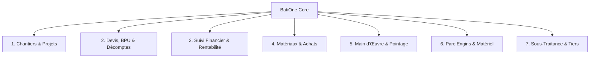

# PRODUCT_SPEC.md — BatiOne Product Specification

## 1. Executive Summary
**BatiOne** is a vertical SaaS ERP designed specifically for Moroccan BTP (Bâtiment et Travaux Publics) contractors, general building companies, and civil engineering firms.

### The Problem
Most Moroccan construction businesses struggle with:
- **Financial Blindspots**: Inability to calculate the real-time profit margin of an ongoing chantier until months after handover.
- **Material Leakage**: Untracked deliveries, unverified on-site material consumption, loss, and theft.
- **Informal Labor & Time Tracking**: Paper-based daily pointage ("carnet de chantier") leading to payroll disputes and unallocated labor costs.
- **Cashflow Delays**: Complex Moroccan public and private billing cycles (Bordereau des Prix, attachements, décomptes provisoires, retenues de garantie) causing severe payment delays.

### The Value Proposition
BatiOne gives contractors real-time control over their sites:
- **Instant Job-Costing**: Compare budgeted costs vs. actual expenses across materials, labor, equipment, and sub-contractors.
- **Mobile-Ready Site Supervision**: On-site pointage and delivery validation even under poor connectivity.
- **Moroccan BTP Compliant**: Native support for Décomptes, Attachements, Retenue de Garantie (5-10%), Bordereaux des Prix Unitaires (BPU), and Moroccan tax regulations (TVA 20%, 14%).

---

## 2. Target Personas

| Role | Moroccan Title | Primary Responsibilities | Pain Points Addressed |
| :--- | :--- | :--- | :--- |
| **Director / Owner** | Directeur Général / Gérant | Overall company health, cash flow, bidding, final margins | Lack of consolidated visibility across 5–20 active sites |
| **Project Director** | Conducteur de Travaux | Oversees 2–5 chantiers, schedule, procurement approvals | Constant firefighting between site requests and office bills |
| **Site Manager** | Chef de Chantier | On-site execution, daily worker check-in, material receipt | Tedious paper reports, lack of immediate supply feedback |
| **CFO / Accountant** | DAF / Responsable Administratif & Financier | Invoicing, décomptes, supplier payments, payroll validation | Disconnected bills, lost delivery notes (bons de livraison) |
| **Depot Manager** | Magasinier | Depot inventory, tools, equipment dispatch & maintenance | Untracked tools, lost stock between depot and chantiers |

---

## 3. Core Functional Modules

### Module 1: Chantiers & Projets (Site Lifecycle)
- **Status workflow**: `Devis / Étude` ➔ `En Cours` ➔ `Réception Provisoire` ➔ `Réception Définitive` ➔ `Clôturé`.
- **Site Profile**: Client (Maître d'Ouvrage), Project Architect/BET (Maître d'Œuvre), Bureau de Contrôle, Location (Morocco cities/regions), Start/End dates, Contract value.
- **Daily Site Log (Journal de Chantier)**: Weather conditions, work completed, incidents, photos, inspection visits.

### Module 2: Devis, Bordereau des Prix (BPU) & Décomptes
- **Bordereau des Prix Unitaires**: Itemized work breakdown (Terrassement, Gros Œuvre, Étanchéité, Revêtement, Électricité, Plomberie, Peinture).
- **Métrés & Quantités**: Estimated vs. actual executed quantities.
- **Décomptes Provisoires (Monthly Invoices)**:
  - Cumulative billing based on accepted monthly attachments.
  - Automatic deduction of previous décomptes.
  - Automatic deduction of Retenue de Garantie (standard 5% or 10%).
  - Application of Moroccan TVA (20% default).

### Module 3: Suivi Financier & Rentabilité en Temps Réel
- **Job Costing Breakdown**:
  - Matériaux (Purchases + Deliveries allocated to the site).
  - Main d'œuvre (Daily/Hourly wages calculated from pointage).
  - Matériel / Engins (Internal rental amortization + external equipment hire).
  - Sous-Traitance (Subcontractor contracts and progress payments).
  - Frais Généraux de Chantier (Installation, electricity, permits).
- **Variance Analysis**: Budget Prévu vs. Dépenses Réelles vs. Décomptes Facturés vs. Encaissés.
- **Marge Nette & Marge Brute**: Dynamic calculation of gross and net margin per chantier.

### Module 4: Gestion des Matériaux, Bons de Commande & Stocks
- **Procurement Cycle**: Demande d'Achat (DA) ➔ Bon de Commande (BC) ➔ Bon de Livraison (BL) ➔ Facture Fournisseur.
- **BL Reconciliation**: Matching site BL (signed by Chef de Chantier) with accounting invoices before payment release.
- **Stock Depots & Site Stocks**: Transfer tracking between central warehouse and active sites.

### Module 5: Pointage Équipes & Main d'Œuvre
- **Worker Registry**: Ouvriers permanents vs. Journaliers (casual laborers).
- **Daily Pointage**: Quick mobile check-in by Chef de Chantier (Présent, Absent, Demi-journée, Heures supplémentaires).
- **Automated Payroll Ledger (État de Paie)**: Bi-monthly or monthly wage generation, cash advances (acomptes), and labor cost distribution per chantier.

### Module 6: Gestion du Parc Matériel & Engins
- **Equipment Inventory**: Heavy machinery (grues, pelleteuses, camions), light equipment (bétonnières, marteaux-piqueurs, échafaudages).
- **Site Allocation**: Tracking which equipment is deployed at which chantier.
- **Maintenance & Operating Costs**: Fuel consumption (gasoil), regular servicing, and internal hourly rental charge to the site budget.

### Module 7: Sous-Traitants & Partenaires
- **Subcontractor Contracts**: Scope of work, contract sum, progress tracking, and retention.
- **Attachements Sous-Traitants**: Validating progress before paying subcontractor invoices.

---

## 4. Non-Functional Requirements

| Metric | Target |
| :--- | :--- |
| **Availability** | 99.9% uptime SLA for cloud deployment |
| **Response Time** | P95 < 250ms for API read operations, < 500ms for mutations |
| **Offline Support** | Mobile site check-in & BL photos cached locally and synced upon reconnection |
| **Data Residency** | Compliant with Moroccan CNDP (Law 09-08) for personal employee data |
| **Multi-Tenancy** | Strict tenant partitioning at database query level |
| **Export Formats** | Official PDF exports (Devis, Décomptes, Bons de Commande, Journal de Chantier) and Excel/CSV data exports |
