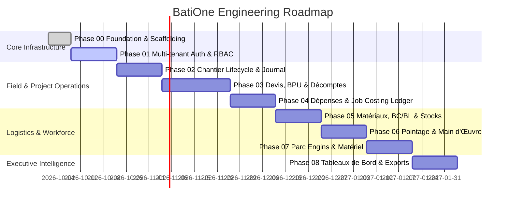

# ROADMAP.md — Project Delivery Roadmap & Milestones

## 1. Roadmap Overview

The development of BatiOne is broken down into structured, verifiable phases to ensure stability, security, and immediate business value for construction companies.

---

## 2. Phase Breakdown & Deliverables

### Phase 00: Foundation, Architecture & Tooling Setup
- Repository scaffolding, configuration, linting, git hooks, CI scripts.
- Design token system and typography (Inter / Outfit, rich dark/light BTP aesthetic).
- Database migration engine and baseline environment configuration.

### Phase 01: Multi-Tenant Core, Authentication & User Management
- Organization profile (ICE, RC, IF, Patente, company branding).
- Secure JWT authentication with refresh token rotation.
- Role-Based Access Control (`ORG_ADMIN`, `CONDUCTEUR_TRAVAUX`, `CHEF_CHANTIER`, `DAF_COMPTABLE`, `MAGASINIER`).
- Tenant isolation middleware with 100% test coverage.

### Phase 02: Chantier & Project Lifecycle Management
- Site registry with Moroccan geographic taxonomy (Casablanca-Settat, Rabat-Salé-Kénitra, Tanger-Tétouan, Marrakech-Safi, etc.).
- Site status state machine (`ETUDE` ➔ `EN_COURS` ➔ `RECEPTION_PROVISOIRE` ➔ `RECEPTION_DEFINITIVE` ➔ `CLOTURE`).
- Daily site log (Journal de Chantier) with photo attachments and weather logging.

### Phase 03: Devis, Bordereau des Prix (BPU) & Décomptes Provisoires
- Interactive Bordereau des Prix editor (m², m³, ml, unit prices in MAD).
- Monthly Décompte generator with automatic cumulative deductions.
- Moroccan Retenue de Garantie (5% / 10%) and TVA (20%) calculation engine.
- High-fidelity PDF export of official Décomptes for Maître d'Ouvrage submission.

### Phase 04: Dépenses, Suivi Financier & Rentabilité Réelle
- Real-time job costing ledger categorizing expenses (Matériaux, MO, Matériel, Sous-traitance, Frais Généraux).
- Receipt upload and OCR / metadata tagging.
- Budget Prévu vs. Dépenses Réelles variance analysis.
- Live gross and net profit margin calculator per active site.

### Phase 05: Matériaux, Bons de Commande & Stocks Chantier
- Purchase request (Demande d'Achat) and Purchase Order (Bon de Commande) workflows.
- On-site receipt validation: Chef de Chantier checks and signs Bon de Livraison (BL).
- Three-way matching (BC ➔ BL ➔ Supplier Invoice) before payment authorization.
- Central warehouse depot vs. site stock inventory tracking.

### Phase 06: Pointage Équipes & Main d'Œuvre
- Worker directory (Ouvriers permanents, journaliers, tâcherons) with CIN and trade classification.
- Mobile-friendly fast daily pointage interface for Chefs de Chantier.
- Automated payroll preview (État de Paie) and cash advance tracking (acomptes).
- Labor cost auto-allocation to individual site job-costing ledgers.

### Phase 07: Parc Engins & Matériel
- Equipment fleet registry (cranes, excavators, dump trucks, scaffolding, concrete mixers).
- Site deployment scheduling and return tracking.
- Operating hour logging, fuel (gasoil) consumption logs, and maintenance alerts.
- Internal machinery rental hourly charging against the project budget.

### Phase 08: Tableaux de Bord Exécutifs, Reporting & Export
- Executive cockpit for Directors (consolidated turnover, margin trends, cash collection delays).
- Project Director view (comparative performance across all assigned chantiers).
- Export engine: Excel financial exports, client reports, CNSS-ready workforce archives.
